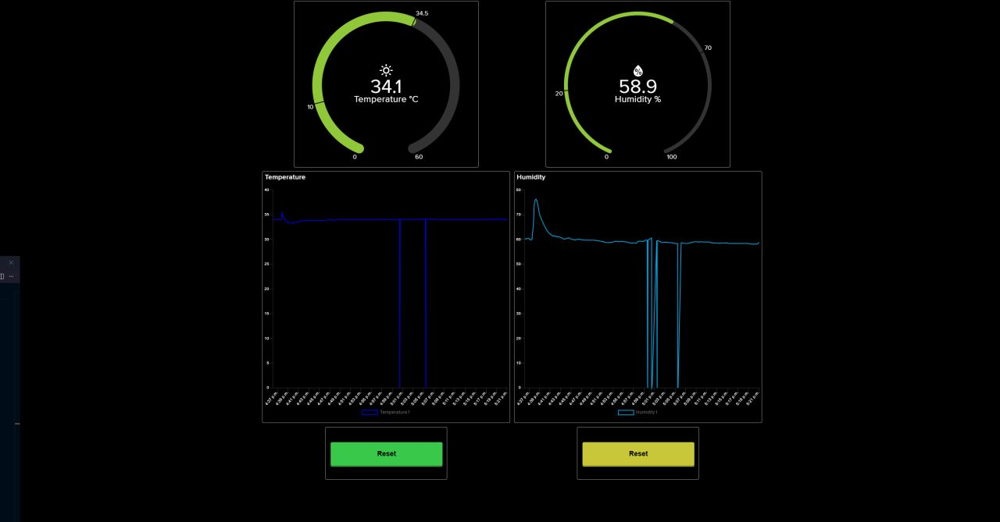
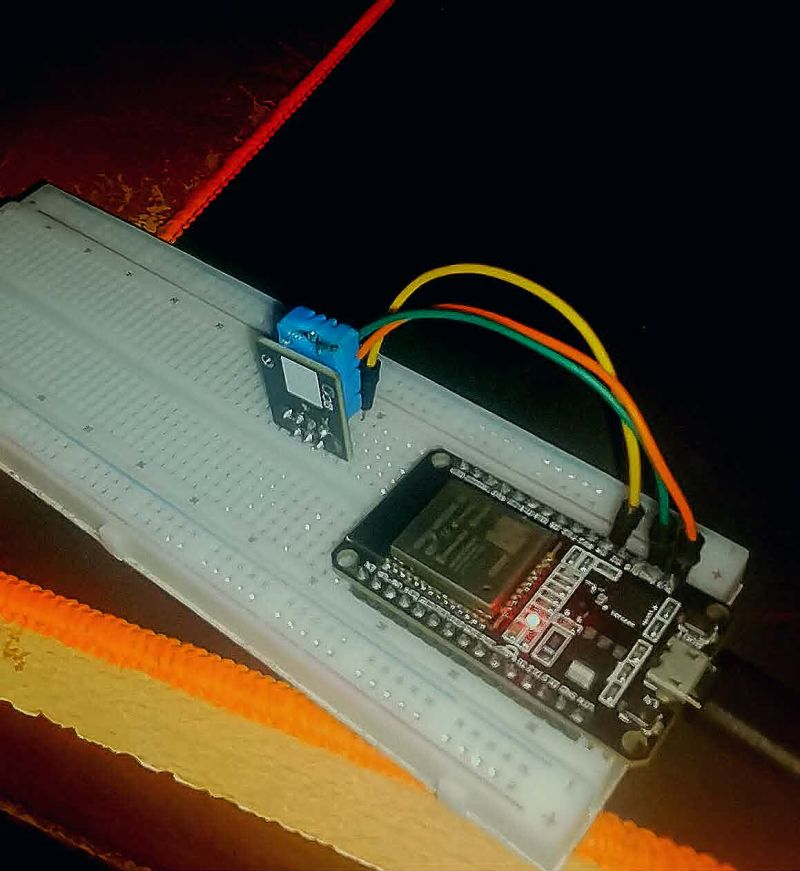

# ESP32 Temperature & Humidity Monitor

A real-time IoT monitoring project built around an ESP32 and a DHT11 sensor. The ESP32 reads temperature and humidity every 5 seconds and publishes the data as a JSON payload over MQTT. A Node-RED flow subscribes to the readings, visualises live data on a dashboard, and can send commands back to the device — including LED control and JSON-based configuration payloads.

## ⚡ TL;DR

The ESP32 connects to Wi-Fi and an MQTT broker, then periodically reads temperature and humidity from a DHT11 sensor. Readings are serialised as JSON and published to the `DHT11/readings` topic. Node-RED subscribes to that topic to display live charts and gauges. Node-RED can also publish back to `LedState` (to toggle the onboard LED) or `JSONfromNodeRED` (to send structured configuration such as a threshold value).

---

## ✨ Key Features

- Periodic DHT11 sensor reads every **5 seconds** with JSON payload publishing over MQTT
- Bidirectional MQTT communication — the ESP32 both publishes readings and subscribes to incoming commands
- **LED remote control** via the `LedState` topic (`ON` / `OFF`)
- **JSON command handling** — parses incoming JSON from Node-RED (e.g. device name, threshold)
- Auto-reconnect logic for both Wi-Fi and MQTT with detailed error code logging
- Node-RED dashboard with live temperature and humidity gauges, charts, and LED toggle switch
- Clean separation of credentials (`credentials.h`) from application logic

---

## 🔄 How It Works

```
ESP32 Boot
    → Connects to Wi-Fi (auto-restarts after 30 s timeout)
    → Connects to MQTT broker with random client ID
    → Subscribes to: fromNodeRED | LedState | JSONfromNodeRED

Loop (every 5 s)
    → Reads DHT11 temperature & humidity
    → Serialises data as JSON: { device, temperature, humidity, timestamp }
    → Publishes JSON to topic: DHT11/readings

Incoming MQTT messages
    → fromNodeRED   : logs the plain-text message
    → LedState      : turns onboard LED ON or OFF
    → JSONfromNodeRED: deserialises JSON, extracts device & threshold fields

Node-RED
    → Subscribes to DHT11/readings and displays live gauges & charts
    → Provides a dashboard switch to publish to LedState
    → Can inject JSON payloads to JSONfromNodeRED for configuration
```

---

## 🔧 Hardware

| Component | Purpose |
|-----------|---------|
| ESP32 | Main microcontroller — Wi-Fi, MQTT client, GPIO control |
| DHT11 | Temperature and humidity sensor |
| Onboard LED | Visual feedback — toggled remotely via MQTT |

---

## 🔌 Wiring

| Component | ESP32 GPIO |
|-----------|-----------|
| DHT11 Data | GPIO 4 |
| Onboard LED | GPIO 2 (built-in) |
| DHT11 VCC | 3.3 V |
| DHT11 GND | GND |

> The DHT11 data line should have a 10 kΩ pull-up resistor between VCC and Data for reliable readings.

---

## 📡 MQTT Topics

| Topic | Direction | Payload | Description |
|-------|-----------|---------|-------------|
| `DHT11/readings` | ESP32 → Broker | JSON | Temperature, humidity, timestamp |
| `LedState` | Broker → ESP32 | `ON` / `OFF` | Controls the onboard LED |
| `fromNodeRED` | Broker → ESP32 | Plain text | General messages from Node-RED |
| `JSONfromNodeRED` | Broker → ESP32 | JSON | Structured config (device, threshold) |

### Published JSON example

```json
{
  "device": "Temperature & Humidity Monitor",
  "temperature": 24.5,
  "humidity": 61.0,
  "timestamp": 15320
}
```

---

## 🖥️ Project Images

### Node-RED Flow


### Node-RED Dashboard



### MQTT Realtime Data



---

## 🗂️ Project Structure

```
TempHumid-RealProject/
├── src/
│   ├── main.cpp          # Setup, loop, Wi-Fi & MQTT reconnect logic
│   ├── WifiMQTT.h        # Wi-Fi connect, MQTT reconnect, callback, DHT publish
│   └── credentials.h     # SSID & password (excluded from version control)
├── images/
│   ├── Dashboard.jpg
│   ├── Node-red Nodes.jpg
│   └── Realtime.jpg
└── platformio.ini        # PlatformIO build configuration
```

---

## ⚙️ Dependencies

Managed via PlatformIO (`platformio.ini`):

| Library | Version | Purpose |
|---------|---------|---------|
| `knolleary/PubSubClient` | `^2.8` | MQTT client |
| `bblanchon/ArduinoJson` | `^7.2.2` | JSON serialisation / deserialisation |
| `adafruit/DHT sensor library` | `^1.4.7` | DHT11 driver |

---

## 🚀 Getting Started

### 1 — Clone & open in PlatformIO

```bash
git clone <your-repo-url>
cd TempHumid-RealProject
```

Open the folder in **VS Code** with the PlatformIO extension installed.

### 2 — Configure credentials

Create `src/credentials.h` (already git-ignored):

```cpp
#pragma once

const char* ssid     = "YOUR_WIFI_SSID";
const char* password = "YOUR_WIFI_PASSWORD";
```

### 3 — Configure the MQTT broker

In `src/WifiMQTT.h`, update the broker details to match your setup:

```cpp
const char *mqtt_server   = "192.168.x.x";   // Your broker IP
const char *mqtt_user     = "your_user";
const char *mqtt_password = "your_password";
```

The default port is **1884**. Adjust `client.setServer(mqtt_server, 1884)` in `main.cpp` if your broker uses a different port.

### 4 — Flash the ESP32

```bash
pio run --target upload
pio device monitor --baud 115200
```

### 5 — Import the Node-RED flow

- Open Node-RED (default: `http://localhost:1880`)
- Go to **☰ → Import** and paste your exported flow JSON
- Deploy and open the dashboard at `http://localhost:1880/ui`

---

## 🔒 Security Note

`credentials.h` is listed in `.gitignore` and should **never** be committed to a public repository. The MQTT password in `WifiMQTT.h` should also be moved to `credentials.h` before pushing to a shared remote.
